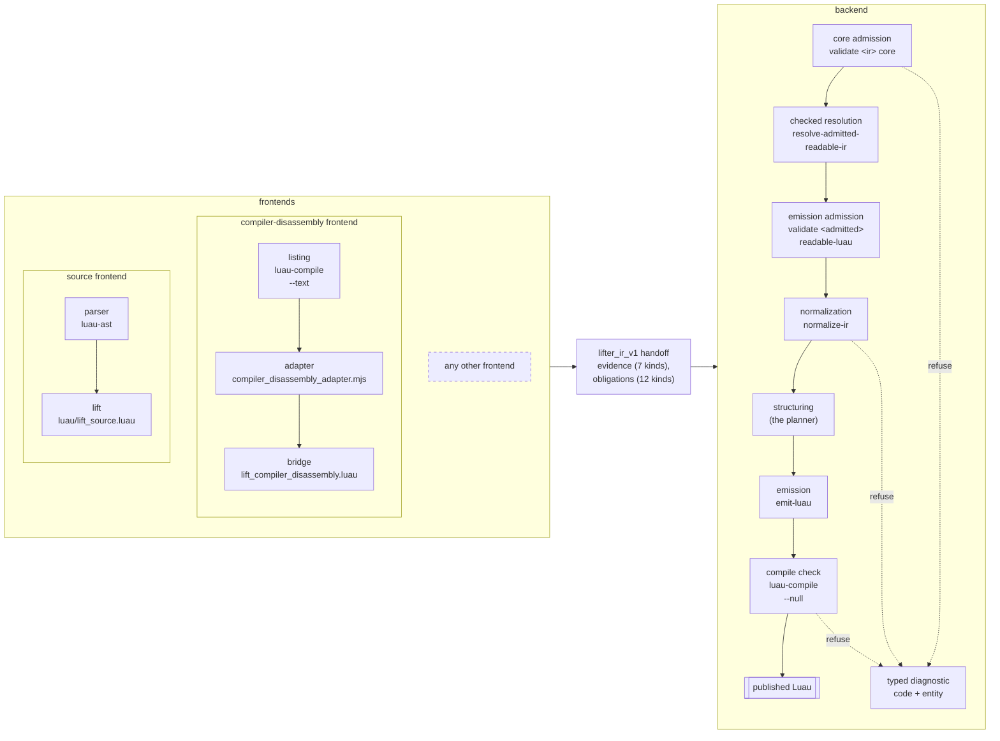

# Semantic-Lifter

**A checked lifting backend for Luau.**

A frontend hands Semantic-Lifter a program as `lifter_ir_v1`, a typed intermediate representation. The backend validates, resolves and restructures it, then emits readable Luau that the official Luau compiler accepts. Anything it cannot justify is refused with a typed diagnostic. The repository ships the backend, a source frontend (Luau source to IR) and a compiler-disassembly frontend (a `luau-compile` text listing to IR).

## Quick start

Requirements: [Zig 0.16.0](https://ziglang.org/download/), [Lune 0.10.4](https://github.com/lune-org/lune/releases), [Luau 0.720](https://github.com/luau-lang/luau/releases/tag/0.720) tools (`luau-compile`, `luau-ast`, `luau-analyze`), [Node 24](https://nodejs.org/).

Build (an option can be left out when that tool is on `PATH` under its own name):

```sh
zig build -Doptimize=ReleaseFast -Dlune=<path> -Dluau-compile=<path> -Dluau-ast=<path> -Dluau-analyze=<path> -Dnode=<path>
```

Lift a Luau file and emit it (`semantic-lifter` is installed under `zig-out/bin/`):

```sh
lune run luau/lift_source.luau <path to luau-ast> <input.luau> <program-id> <program.ir.json>
semantic-lifter emit-luau <program.ir.json> <output.luau> standard-luau <path to luau-compile>
```

See [docs/usage.md](docs/usage.md) for tests, the disassembly path, other commands, exit codes and `build.ps1`.

## Features

- **Typed evidence contract**: 7 evidence kinds, 12 obligation kinds, 241 typed diagnostics, 2 admission profiles (`core`, `readable-luau`).
- **Checked resolution**: only proved facts change the program, as replayable CFG rewrites; internal engine, optional [Z3 backend](docs/usage.md#requirements).
- **Restructuring**: `if`, `while`, `break`, `continue`, native numeric and generic `for`; guarded node splitting, within a growth budget, for irreducible control.
- **Compiler-limit admission**: 200 live locals, 255 registers, 200 upvalues per nested function, jump budget, syntax depth, child prototypes.
- **Compile-gated output**: `standard-luau` or `direct-locals-luau`, published only after `luau-compile` accepts it.
- **Source frontend**: declarations, plain and compound assignment, `if`, `while`, `repeat`, both `for` forms, `break`, `continue`, open returns, closures, varargs, tables, method calls, string interpolation, `and`/`or` and `if` expressions.
- **Compiler-disassembly frontend**: lifts a selected function from a `luau-compile --text` listing; the caller declares its signature.
- **Tests**: over 800 unit tests; 48 fixture files, 28 conformance scripts, 9 audits, 7 oracles; emitted programs are compiled and run.

## Pipeline



## Example

The tracked fixture `luau/fixtures/loop_control_source.luau`:

```luau
return function(limit)
	local total = 0
	local index = 0
	while index < limit do
		index = index + 1
		if index == 3 then
			continue
		end
		if index == 6 then
			break
		end
		total = total + index
	end
	return total
end
```

lifted through the source path and emitted (see [docs/usage.md](docs/usage.md#command-line-use)):

```sh
lune run luau/lift_source.luau <path to luau-ast> luau/fixtures/loop_control_source.luau loop_control loop_control.ir.json
semantic-lifter emit-luau loop_control.ir.json loop_control.luau standard-luau <path to luau-compile>
```

```luau
local value_18 = function(limit)
  local total = 0
  local index = 0
  while true do
    if index < limit then
      index += 1
      if not (index == 3) then
        if index == 6 then
          do
            break
          end
        else
          total += index
        end
      end
    else
      do
        break
      end
    end
  end
  return total
end
return value_18
```

The backend rebuilt the loop from the control-flow graph in the IR, not from the source text.

## Repository

- `src/`: the backend and the `semantic-lifter` CLI.
- `luau/`: the source frontend, IR library and codec, and conformance suite.
- `frontends/disassembly/`: the compiler-disassembly frontend with its tests.
- `build.zig`, `build.ps1`: the build graph and its Windows wrapper.
- [`docs/usage.md`](docs/usage.md): requirements, build and command-line use.
- [`docs/design.md`](docs/design.md): how it works and what it handles.
- `LICENSE`, `CONTRIBUTING.md`, `CITATION.cff`, `.gitattributes`.

The issue tracker holds the open items; anything else is welcome as an issue.

## Citation

This repository implements the forthcoming preprint *Checked, Not Trusted: Typed Evidence Contracts and Paired-Representation Testing for Luau Lifting Backends*.

```bibtex
@misc{luawl2026semanticlifter,
  title  = {Checked, Not Trusted: Typed Evidence Contracts and Paired-Representation Testing for Luau Lifting Backends},
  author = {Luawl},
  year   = {2026},
  note   = {Preprint. Code: https://github.com/luawl/semantic-lifter},
}
```

## Licence

MIT (`LICENSE`), copyright Luawl.
