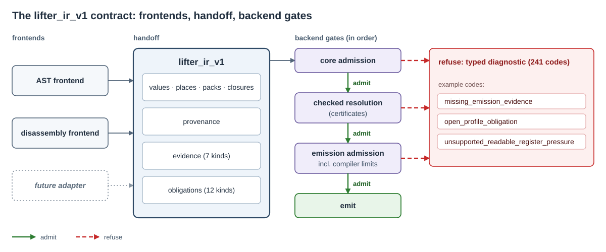
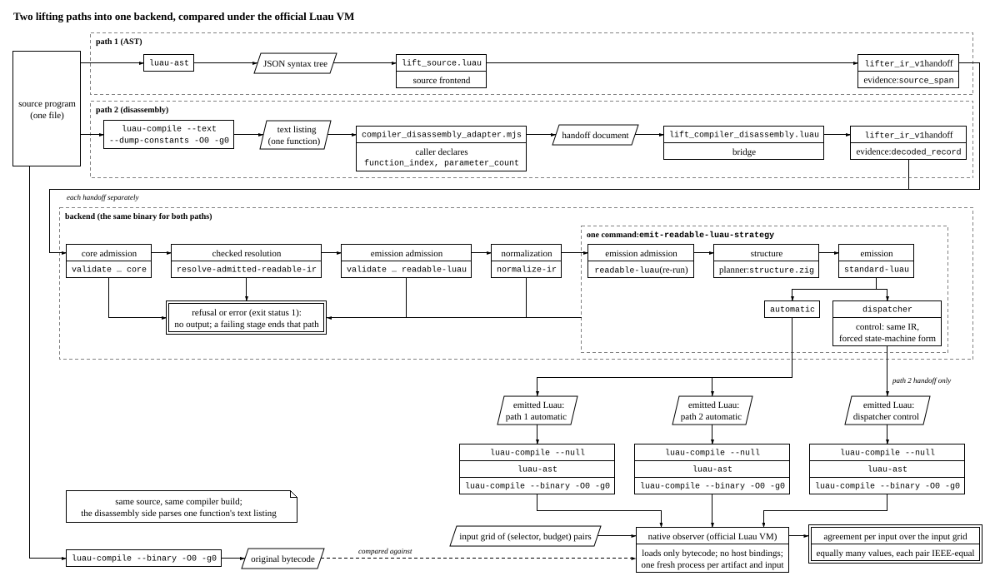
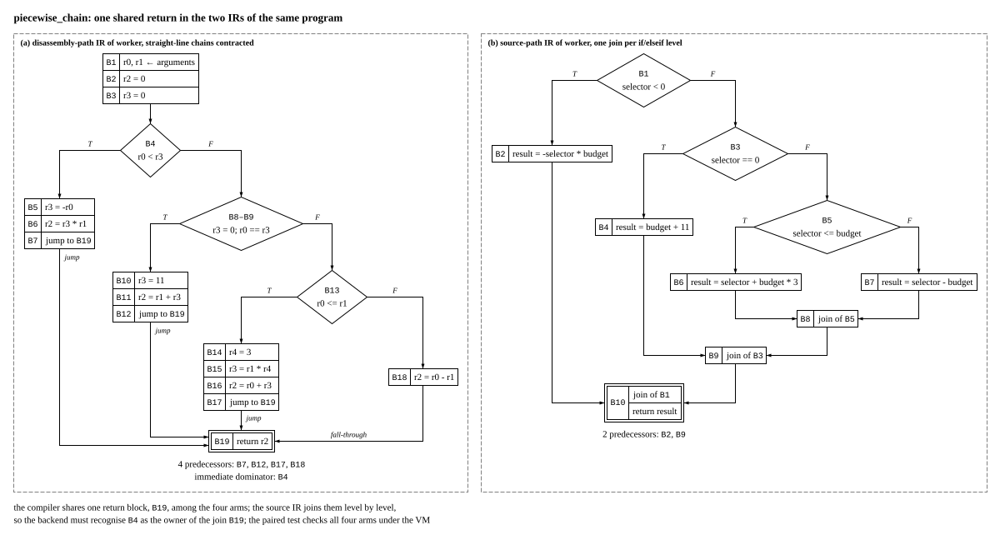

# Semantic-Lifter

Semantic-Lifter is a checked lifting backend for Luau. It takes a program that a frontend has
recovered as `lifter_ir_v1`, a typed intermediate representation, and produces readable Luau that
the official Luau compiler accepts; whatever it cannot justify, it refuses with a typed diagnostic.
It works under a typed evidence contract: output is published only for a program that passes an
admission profile, `core` for the IR and `emission` for readable Luau output (`readable-luau` on the
command line), and every refusal is a code plus the index of the IR entity it concerns. The preprint
tests the design on paired representations: one program is lifted through the source path (the Luau
parser's syntax tree) and through the compiler-disassembly path (the official compiler's text
listing), and each result is run against the original under the official Luau VM.

This repository ships the backend and two frontends: the source frontend, which lifts Luau source to
`lifter_ir_v1`, and the compiler-disassembly frontend, which lifts the compiled function that
`function_index` selects from a `luau-compile --text` listing. Both start from a program whose
source is at hand, so that the original can serve as the reference. A frontend is any component that
writes a `lifter_ir_v1` handoff: a lifting or analysis tool supplies the frontend for the artefact
it targets, and the contract is what that frontend has to satisfy.

The backend is about 148,000 lines of Zig across 159 files, with over 800 unit tests. The source
frontend, the IR library and codec, and the conformance suite take about 55,000 lines across 168
files under `luau/`. The suite holds 48 fixture files, 28 conformance scripts, 9 audits and 7
oracles; it compiles the emitted programs with the official Luau compiler and runs its oracles under
Lune, a standalone Luau runtime.

The preprint that describes the design will be published separately and linked here.

## What it handles

**Source path.** The source frontend covers declarations, plain and compound assignment, `if`,
`while`, `repeat`, both `for` forms, `break`, `continue`, open returns, closures, varargs, tables,
method calls, string interpolation, `and`/`or` and `if` expressions. An unsupported construct is
refused with a typed diagnostic, never lifted silently. Before the handoff, the frontend admits the
parser's syntax tree in a bounded preflight, checks every runtime local's canonical identity, owning
function and lexical visibility, and lowers expressions and result packs in Luau's evaluation
order. Numeric and generic `for` loops keep their hidden state for the backend to validate and
re-emit, and a table constructor whose keys can fail is lowered to explicit ordered writes. Once the
whole program is known, place domains are finalised: closure bindings make each captured-place
alias class explicit, and a class is refined only when all of its writes agree on one domain.

**Backend.**

- **Validation.** The checked pipeline validates every handoff under the typed evidence contract: 7 evidence kinds, 12
  obligation kinds, 241 typed diagnostics and 2 admission profiles. The validators cover types,
  ownership, closures, operations, declared effects, packs, the dominance of every use, and the
  consistency of claims, obligations, certificates and CFG rewrites; an open obligation blocks the
  profile it names.
- **Solving.** Checked resolution answers the queries that frontends attach to obligations and
  those the backend derives from control facts. Only proved facts change the program, as replayable
  CFG rewrites; an unknown answer leaves its obligation open, and admission re-checks certificates,
  models and digests rather than trusting the run that produced them. The internal engine is the
  default; an optional Z3 backend is built with `-Dz3=true`.
- **Restructuring.** Planned regions become nested `if` statements, `while` loops with `break` and
  `continue`, and native numeric and generic `for` loops. Irreducible control, such as a loop
  entered at two points, goes through guarded node splitting within a growth budget; each
  redirected edge is logged as a rewrite that validation replays. The conformance cases cover loop
  topologies; edge-scoped, relational and chained branch control; and irreducible control carrying
  closure captures, coroutines, table construction, string interpolation, and numeric and generic
  iteration, which must come out as native `for` loops.
- **Emission.** Before any Luau is written, compiler-limit admission reports each predicted excess
  over the compiler's limits as a typed diagnostic: 200 live locals including parameters, 255
  registers for locals plus temporaries, 200 upvalues per nested function, the jump budget, syntax
  depth and child prototypes. Value fusion folds a value used exactly once into its consumer when
  evaluation order allows. The two output forms are `standard-luau`, which captures the builtins it
  uses when the chunk starts, and `direct-locals-luau`, which prefers lexical locals for private
  values. The official compiler is the final gate: `emit-luau` publishes its output only after the
  given `luau-compile` accepts it.

**Verification.** Over 800 unit tests cover the backend. The conformance suite lifts its source
fixtures and builds IR from its conformance scripts, then resolves, validates, emits and compiles
the programs; runtime oracles execute the output, and for source fixtures the original program too,
against the results each case expects. The irreducible-control audits check what resolution and
node splitting wrote: each clone takes fresh identities and keeps its arity, successors and
provenance, and resolving a resolved program again leaves it byte-identical. A structure audit
parses the output with `luau-ast` and requires structured branches and loops, and a refusal audit
checks that a refused resolution prints its diagnostic and writes no file. A compiler-limit oracle
checks that the official compiler accepts a program at each limit above and rejects it one step
past; a lexical oracle checks with `luau-analyze` that emitted code introduces no global the source
did not use. In the release build, every unit test and every conformance step passes.

## Example

The tracked fixture `luau/fixtures/loop_control_source.luau`:

```luau
return function(limit)
	local total = 0
	local index = 0
	while index < limit do
		index = index + 1
		if index == 3 then
			continue
		end
		if index == 6 then
			break
		end
		total = total + index
	end
	return total
end
```

lifted through the source path and emitted (the two commands are explained under "Command-line use"):

```sh
lune run luau/lift_source.luau <path to luau-ast> luau/fixtures/loop_control_source.luau loop_control loop_control.ir.json
semantic-lifter emit-luau loop_control.ir.json loop_control.luau standard-luau <path to luau-compile>
```

```luau
local value_18 = function(limit)
  local total = 0
  local index = 0
  while true do
    if index < limit then
      index += 1
      if not (index == 3) then
        if index == 6 then
          do
            break
          end
        else
          total += index
        end
      end
    else
      do
        break
      end
    end
  end
  return total
end
return value_18
```

The output is what the backend published after the official compiler accepted it. The backend rebuilt
the loop from the control-flow graph in the IR, not from the source text, so the result is a structured
rendering of the program rather than a copy of it.

## How it works



A frontend hands the backend a `lifter_ir_v1` program with evidence on every entity. The backend admits it under the `core` profile, resolves and restructures it, and publishes readable Luau only under the `emission` profile; anything it cannot justify becomes a typed diagnostic that names the entity and, for an obligation, its kind and the profile it blocks.



In the preprint's paired tests, the same program is lifted twice, once from its syntax tree and once from the official compiler's disassembly listing, through the same backend; both outputs and a forced-dispatcher control are executed against the original under the official Luau VM over an input grid. A disagreement is a finding, never silenced.



The figure draws one program, `piecewise_chain`, as each path presents it. On the disassembly path
the compiler shares one return block among the four arms; on the source path each inner `if`/`elseif`
level has its own join, and the outer join holds the single return. One program reaches the backend as two different
graphs, which is why the backend is tested on both; a regression test for this program is in the
repository.

## Release note

This repository is the implementation behind the forthcoming preprint *Checked, Not Trusted: Typed Evidence Contracts and Paired-Representation Testing for Luau Lifting Backends*: the backend and the frontends in this repository, cleaned up for release. The build section below verifies the backend and the source frontend (every unit test and conformance step passes, and a fresh clone builds with the documented tool options), and `node --test` runs the compiler-disassembly frontend's tests. The preprint reports the evaluation and the issue tracker holds the open items; anything else is welcome as an issue.

## Repository contents

- `src/`: the backend (IR, validation, solving, restructuring, emission) and the command-line
  interface, `semantic-lifter`.
- `luau/`: the source frontend, the IR library and codec, and the conformance fixtures and audits.
- `research/compiler_disassembly_adapter.mjs` and `research/lift_compiler_disassembly.luau`: the
  compiler-disassembly frontend (`research/compiler_disassembly_adapter.test.mjs` tests the adapter).
- `build.zig` and `build.ps1`: the build graph and its Windows wrapper.
- `LICENSE`, `CONTRIBUTING.md` and `.gitattributes`.

Manuscripts, run records and evidence archives will be published with the preprint.

## Requirements

- Zig 0.16.0 ([ziglang.org downloads](https://ziglang.org/download/)).
- Lune 0.10.4 ([lune-org/lune releases](https://github.com/lune-org/lune/releases)).
- The Luau 0.720 command-line tools `luau-compile`, `luau-ast` and `luau-analyze`
  ([luau-lang/luau releases, tag `0.720`](https://github.com/luau-lang/luau/releases/tag/0.720)).
- Node 24, only for the disassembly adapter and its test
  (`node --test research/compiler_disassembly_adapter.test.mjs`).
- Z3, optional and maintainers-only for now: `-Dz3=true` (off by default) links the Z3 4.16.0 C API
  from a fixed location outside the repository that `build.zig` names; 61 tests compile only with it.

## Build and test

Every `zig build` command resolves the four external tools before it runs any step, so each command
below takes their paths. An option can be left out when that tool is on `PATH` under its own name.

```sh
zig build test -Doptimize=ReleaseFast -Dlune=<path> -Dluau-compile=<path> -Dluau-ast=<path> -Dluau-analyze=<path>
zig build conformance -Doptimize=ReleaseFast -Dlune=<path> -Dluau-compile=<path> -Dluau-ast=<path> -Dluau-analyze=<path>
zig build -Doptimize=ReleaseFast -Dlune=<path> -Dluau-compile=<path> -Dluau-ast=<path> -Dluau-analyze=<path>
```

`test` runs the Zig unit tests and the Luau frontend's tests; `conformance` validates, emits,
compiles and runs the generic fixtures and audits; the install step (the last line) puts `semantic-lifter.exe`, with the `proof-attest.exe`
helper, under `zig-out/bin/`. `-Doptimize` also takes `Debug` and `ReleaseSafe`.

On Windows, `build.ps1 <step> [zig build args]` runs the same build, for example
`pwsh -File build.ps1 test -Doptimize=ReleaseFast`. It uses the Zig toolchain under
`tools\zig-x86_64-windows-0.16.0\` when that directory exists and `zig` from `PATH` otherwise, runs
in the repository root, and adds each of the four tool options that the caller did not pass when it
finds that tool in the maintainers' workspace layout. It never sets `--prefix` or the cache
directories; pass them as arguments when you need them.

With `--summary all`, `test` reports a `Build Summary` in which every step succeeded and
every test passed, and `conformance` one in which every step succeeded; a failing step is named in the step tree that follows the summary line.

## Command-line use

The command-line interface reads `lifter_ir_v1` JSON that a frontend produced. Run the frontends
from the repository root.

Source path (Luau source, parsed by `luau-ast`):

```sh
lune run luau/lift_source.luau <path to luau-ast> <input.luau> <program-id> <program.ir.json>
```

Compiler-disassembly path (the frontend reads the `luau-compile --text` listing, turns the function
that `function_index` selects into a handoff document, then into IR; the one-liner below runs the
compiler and the adapter in one step):

```sh
node --input-type=module -e "import { execFileSync } from 'node:child_process'; import { writeFileSync } from 'node:fs'; import { parseDisassembly } from './research/compiler_disassembly_adapter.mjs'; const [compiler, source, out] = process.argv.slice(1); writeFileSync(out, JSON.stringify(parseDisassembly(execFileSync(compiler, ['--text', '--dump-constants', '-O0', '-g0', source], { encoding: 'utf8' }), { function_index: 0, parameter_count: 2 })));" <path to luau-compile> <input.luau> <handoff.json>
lune run research/lift_compiler_disassembly.luau <handoff.json> <program.ir.json> <program-id>
```

`function_index` selects the compiled function in the listing; the caller declares its signature,
`parameter_count` (default 2) and `is_variadic` (default `false`), which the text listing does not encode.

Then validate, resolve and emit:

```sh
semantic-lifter validate <program.ir.json> core
semantic-lifter resolve-admitted-readable-ir <program.ir.json> <admitted.ir.json>
semantic-lifter emit-luau <program.ir.json> <output.luau> standard-luau <path to luau-compile>
```

`validate` checks the IR against an admission profile (`core` or `readable-luau`).
`resolve-admitted-readable-ir` writes the resolved program that the emission profile admits.
`emit-luau` runs the checked pipeline on the frontend's IR and publishes the Luau output only after
the given `luau-compile` accepts it; `direct-locals-luau` is its other output form.

A refusal is reported on stderr as `diagnostic=<code> entity=<index>` lines (`entity=null` when no
single IR entity applies), some followed by indented detail lines; by default stderr carries nothing
else (the internal stage traces print only in a `-Dtrace-normalize-phases=true` build). Exit status 0
means success; 1 means a refusal or an error such as a missing file or a bad argument, and the stderr
lines say which. A refused `resolve-*` command writes no output file. Running `semantic-lifter`
without arguments prints the usage text.

The usage text lists some commands under "diagnostic-only or unchecked (exit 0 is not a checked
publication)", among them `emit-admitted-readable-luau-raw`, `emit-readable-luau-strategy`,
`emit-function-probe` and `resolve-exact-control-ir`. Each skips admission or part of the checked
pipeline, and the usage text says which. Unlike `emit-luau`, these commands do not gate their own
output, so their output serves analysis, or a harness that gates it separately. In the preprint's paired tests, every file that `emit-readable-luau-strategy` emits must pass
`luau-compile` and `luau-ast` before it runs against the original under the official Luau VM.

## Scope

The backend, the source frontend and the compiler-disassembly frontend are the maintained components
of this repository; an earlier version of the second frontend was the second path of the preprint's paired tests.

## Citation

If this repository is useful for your work, please cite the preprint. The arXiv entry will replace
this block when it is live; `CITATION.cff` carries the same reference.

```bibtex
@misc{luawl2026semanticlifter,
  title  = {Checked, Not Trusted: Typed Evidence Contracts and Paired-Representation Testing for Luau Lifting Backends},
  author = {Luawl},
  year   = {2026},
  note   = {Preprint. Code: https://github.com/luawl/semantic-lifter},
}
```

## Licence

PolyForm Strict License 1.0.0 (`LICENSE`), copyright Luawl.
