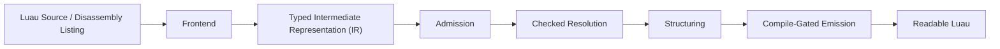

# Semantic-Lifter

**An IR Lifting Backend for Luau**

Semantic-Lifter is a lifting backend for Luau made to validate, resolve, and restructure a typed intermediate representation into readable Luau that compiles under the official Luau compiler.

By separating frontend lifting from the core checks, the backend allows you to develop custom frontends for other Luau representations, each producing the same typed handoff, while reusing the unified checked pipeline.

***This repository serves as the implementation of the forthcoming preprint "Checked, Not Trusted" and contains the backend, a source frontend, and a compiler-disassembly frontend.***

## Documentation Hub

To maintain clarity, everything is separated from one another. **If you are new to Semantic-Lifter, please visit the links below**:

* **[Getting Started & Introduction](docs/README.md)** - Architecture overview, features, and short guides for building, lifting, and emitting.

## Roadmap

To track active milestones, upcoming constructs, and the release of run records, visit our roadmap:

* **[Development Roadmap](docs/roadmap.md)** - Tracking of active milestones, upcoming constructs, solver work, and evidence publication.

## Pipeline

Semantic-Lifter separates frontend lifting from the core backend pipeline, allowing new frontends to reuse the existing admission, checked resolution, structuring, and emission.



## Building and Testing Semantic-Lifter

Each Semantic-Lifter build requires Zig and finds Lune, the Luau tools, and Node through build options or `PATH`.

Detailed building and testing instructions can be found here: [Build and test](docs/usage.md#build-and-test).

## Scripts

Semantic-Lifter includes a PowerShell wrapper, `build.ps1`, for the common build and test invocations on Windows.

More information and usage examples can be found in [build.ps1](build.ps1) and [Build and test](docs/usage.md#build-and-test).

## Testing

**Every program that `emit-luau` publishes is first compiled by the official Luau compiler, and the conformance suite compiles every program it emits and checks what it computes. Two build steps, `test` and `conformance`, run every check.**

### Backend

The **src** directory contains the backend with its unit tests beside the sources.

- [src/](src/) - Backend and its unit tests

### Conformance

The **luau** directory contains the source frontend's tests and the conformance scripts, audits, and oracles that exercise the backend on its fixtures and generated programs.

- [luau/](luau/) - Source frontend tests, conformance scripts, audits, and oracles
- [luau/fixtures/](luau/fixtures/) - Fixtures (Luau sources, manifests, and IR)

### Frontends

The **frontends** directory contains the compiler-disassembly frontend with its Node tests; the source frontend lives in `luau/`.

- [frontends/disassembly/](frontends/disassembly/) - Compiler-disassembly frontend and adapter tests

## Examples

An example lift of a Luau loop, with its emitted output, can be found in [Example](docs/README.md#example).

Command-line usage for both frontends is in [Using Semantic-Lifter](docs/usage.md#command-line-use).

## Citation

This repository implements the forthcoming preprint *Checked, Not Trusted: Typed Evidence Contracts and Paired-Representation Testing for Luau Lifting Backends*.

```bibtex
@misc{luawl2026semanticlifter,
  title  = {Checked, Not Trusted: Typed Evidence Contracts and Paired-Representation Testing for Luau Lifting Backends},
  author = {Luawl},
  year   = {2026},
  note   = {Preprint. Code: https://github.com/luawl/semantic-lifter},
}
```

## License

Semantic-Lifter is a proof of concept published for study. It is licensed under the [PolyForm Strict License 1.0.0](LICENSE). The licence grants a copyright licence "for any permitted purpose, other than distributing the software or making changes or new works based on the software"; noncommercial purposes are permitted purposes, and the required notice must be kept. Commercial use of any kind is not permitted. Changes reach the repository only through the contribution guide, together with a grant of the rights needed to include them.
