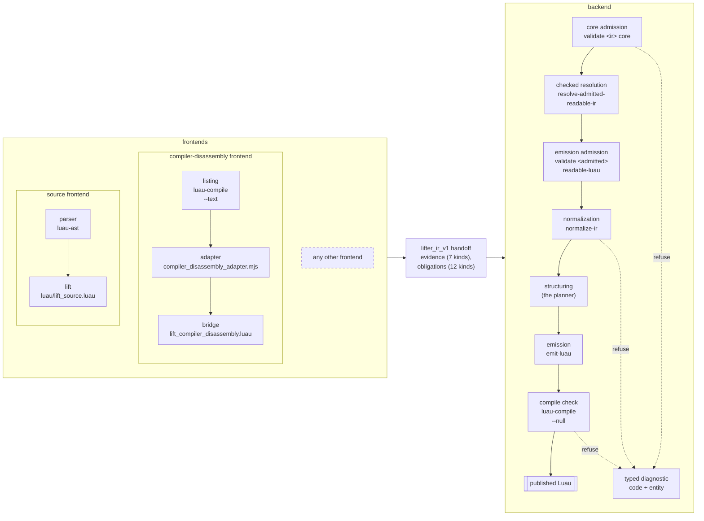
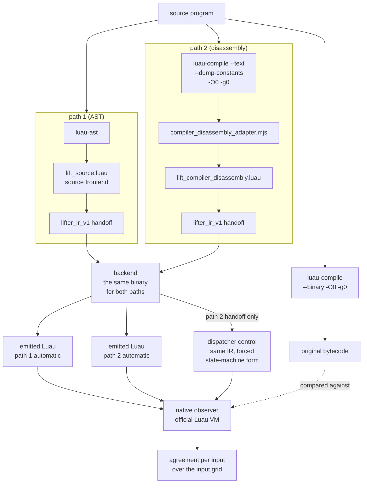
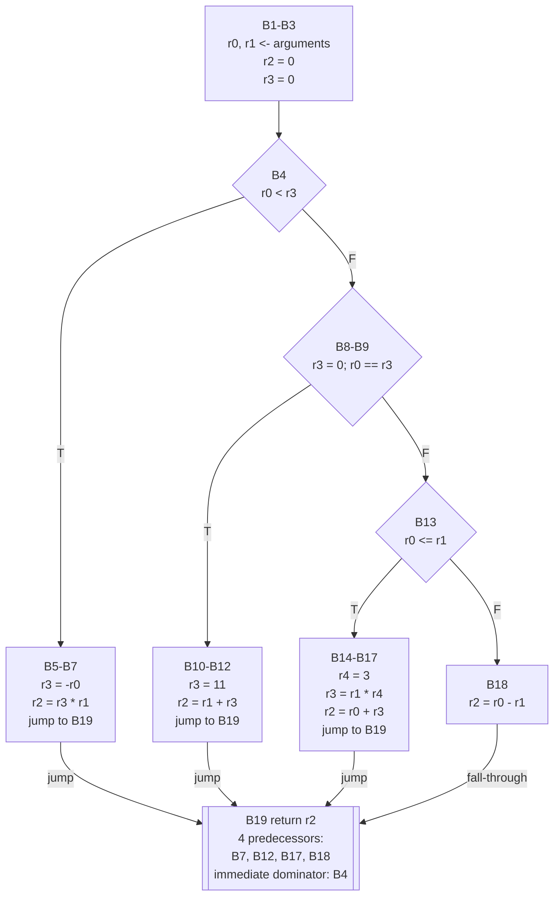
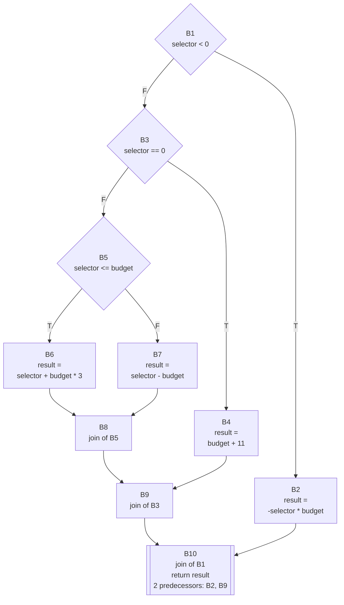

# How Semantic-Lifter works

[Back to the README](../README.md)

Semantic-Lifter is a checked lifting backend for Luau. It takes a program that a frontend has
recovered as `lifter_ir_v1`, a typed intermediate representation, and produces readable Luau that
the official Luau compiler accepts; whatever it cannot justify, it refuses with a typed diagnostic.
It works under a typed evidence contract: output is published only for a program that passes an
admission profile, `core` for the IR and `emission` for readable Luau output (`readable-luau` on the
command line), and every refusal is a code plus the index of the IR entity it concerns. The preprint
tests the design on paired representations: one program is lifted through the source path (the Luau
parser's syntax tree) and through the compiler-disassembly path (the official compiler's text
listing), and each result is run against the original under the official Luau VM.

This repository ships the backend and two frontends: the source frontend, which lifts Luau source to
`lifter_ir_v1`, and the compiler-disassembly frontend, which lifts the compiled function that
`function_index` selects from a `luau-compile --text` listing. Both start from a program whose
source is at hand, so that the original can serve as the reference. A frontend is any component that
writes a `lifter_ir_v1` handoff: a lifting or analysis tool supplies the frontend for the artefact
it targets, and the contract is what that frontend has to satisfy.

The backend is about 148,000 lines of Zig across 159 files, with over 800 unit tests. The source
frontend, the IR library and codec, and the conformance suite take about 55,000 lines across 168
files under `luau/`. The suite holds 48 fixture files, 28 conformance scripts, 9 audits and 7
oracles; it compiles the emitted programs with the official Luau compiler and runs its oracles under
Lune, a standalone Luau runtime.

A frontend hands the backend a `lifter_ir_v1` program with evidence on every entity. The backend admits it under the `core` profile, resolves and restructures it, and publishes readable Luau only under the `emission` profile; anything it cannot justify becomes a typed diagnostic that names the entity and, for an obligation, its kind and the profile it blocks. Every gate refuses the same way; the diagram draws the refuse edge from three of them.

In the preprint's paired tests, the same program is lifted twice, once from its syntax tree and once from the official compiler's disassembly listing, through the same backend; both outputs and a forced-dispatcher control are executed against the original under the official Luau VM over an input grid. A disagreement is a finding, never silenced.

The disassembly-path IR of the worker, straight-line chains contracted:

The source-path IR of the same worker, one join per `if`/`elseif` level:

The figure draws one program, `piecewise_chain`, as each path presents it. On the disassembly path
the compiler shares one return block among the four arms; on the source path each inner `if`/`elseif`
level has its own join, and the outer join holds the single return. One program reaches the backend as two different
graphs, which is why the backend is tested on both; a regression test for this program is in the
repository.

## What it handles

**Source path.** The source frontend covers declarations, plain and compound assignment, `if`,
`while`, `repeat`, both `for` forms, `break`, `continue`, open returns, closures, varargs, tables,
method calls, string interpolation, `and`/`or` and `if` expressions. An unsupported construct is
refused with a typed diagnostic, never lifted silently. Before the handoff, the frontend admits the
parser's syntax tree in a bounded preflight, checks every runtime local's canonical identity, owning
function and lexical visibility, and lowers expressions and result packs in Luau's evaluation
order. Numeric and generic `for` loops keep their hidden state for the backend to validate and
re-emit, and a table constructor whose keys can fail is lowered to explicit ordered writes. Once the
whole program is known, place domains are finalised: closure bindings make each captured-place
alias class explicit, and a class is refined only when all of its writes agree on one domain.

**Backend.**

- **Validation.** The checked pipeline validates every handoff under the typed evidence contract: 7 evidence kinds, 12
  obligation kinds, 241 typed diagnostics and 2 admission profiles. The validators cover types,
  ownership, closures, operations, declared effects, packs, the dominance of every use, and the
  consistency of claims, obligations, certificates and CFG rewrites; an open obligation blocks the
  profile it names.
- **Solving.** Checked resolution answers the queries that frontends attach to obligations and
  those the backend derives from control facts. Only proved facts change the program, as replayable
  CFG rewrites; an unknown answer leaves its obligation open, and admission re-checks certificates,
  models and digests rather than trusting the run that produced them. The internal engine is the
  default; an optional Z3 backend is built with `-Dz3=true -Dz3-dir=<path>` (see [Requirements](usage.md#requirements)).
- **Restructuring.** Planned regions become nested `if` statements, `while` loops with `break` and
  `continue`, and native numeric and generic `for` loops. Irreducible control, such as a loop
  entered at two points, goes through guarded node splitting within a growth budget; each
  redirected edge is logged as a rewrite that validation replays. The conformance cases cover loop
  topologies; edge-scoped, relational and chained branch control; and irreducible control carrying
  closure captures, coroutines, table construction, string interpolation, and numeric and generic
  iteration, which must come out as native `for` loops.
- **Emission.** Before any Luau is written, compiler-limit admission reports each predicted excess
  over the compiler's limits as a typed diagnostic: 200 live locals including parameters, 255
  registers for locals plus temporaries, 200 upvalues per nested function, the jump budget, syntax
  depth and child prototypes. Value fusion folds a value used exactly once into its consumer when
  evaluation order allows. The two output forms are `standard-luau`, which captures the builtins it
  uses when the chunk starts, and `direct-locals-luau`, which prefers lexical locals for private
  values. The official compiler is the final gate: `emit-luau` publishes its output only after the
  given `luau-compile` accepts it.

**Verification.** Over 800 unit tests cover the backend. The conformance suite lifts its source
fixtures and builds IR from its conformance scripts, then resolves, validates, emits and compiles
the programs; runtime oracles execute the output, and for source fixtures the original program too,
against the results each case expects. The irreducible-control audits check what resolution and
node splitting wrote: each clone takes fresh identities and keeps its arity, successors and
provenance, and resolving a resolved program again leaves it byte-identical. A structure audit
parses the output with `luau-ast` and requires structured branches and loops, and a refusal audit
checks that a refused resolution prints its diagnostic and writes no file. A compiler-limit oracle
checks that the official compiler accepts a program at each limit above and rejects it one step
past; a lexical oracle checks with `luau-analyze` that emitted code introduces no global the source
did not use. In the release build, every unit test and every conformance step passes.

## Scope

The backend, the source frontend and the compiler-disassembly frontend are the maintained components
of this repository; an earlier version of the second frontend was the second path of the preprint's paired tests.
